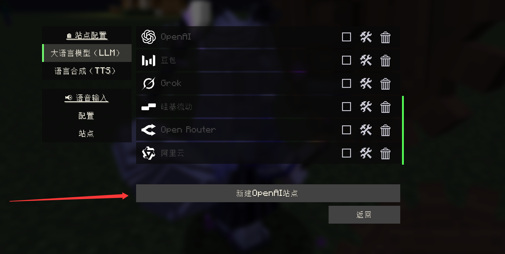
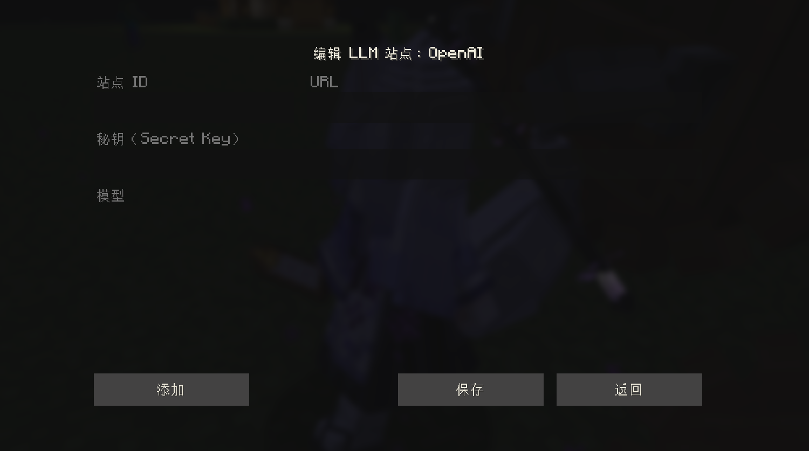

# dsh-maid-bridge（车万女仆桥）

把 **Minecraft 车万女仆（Touhou Little Maid）** 模组的 AI 站点接到 **DeepSeek Harness（DSH）** 会话上的本地 OpenAI 兼容桥。

游戏里的女仆说一句话 → 桥把这句话投递给指定的 DSH 会话 → 等那个会话里的回复 → 按 `chat.completion` 的形状还回去。女仆从此可以用游戏里的「站点」跟 DSH 里的助手聊天，聊天记录同时落在 DSH 会话里，你能随时翻。

## 特性

- 只绑 `127.0.0.1`，不出本机；`Bearer` 密钥校验（未配置密钥 = 接口全关）
- 会话白名单 + 归档会话防护 + 每会话 3 秒限流 + 单并发 + 120 秒超时
- **常驻持有模型**：启动即 resume 白名单里的第一个会话，之后每轮复用同一个 agent（不逐轮 resume/dispose），游戏和 GUI 可以同时用同一个会话
- **支持工具调用**：把车万女仆模组发来的 `tools` 透传给 DSH 会话；DSH 回复里的 `<tool_call>{...}</tool_call>` 会被解析成 OpenAI `tool_calls` 还回去，模组就能真正控制女仆（坐下、跟随、工作、查游戏信息等）
- 带一个宿主 GUI 面板：看密钥状态、会话白名单、请求计数、手动改配置
- 附安装脚本 `scripts/install.mjs`（Plugin Manager 的等价兜底：link 依赖 + 加入 bundles + 建 junction，失败自动回滚）

## 安装

### 方式一：DSH Plugin Manager（推荐）

在 DSH 的插件管理里安装 `dsh-maid-bridge` bundle。

### 方式二：脚本

```bash
node scripts/install.mjs                 # 安装到 desktop profile
node scripts/install.mjs --dry-run       # 只看会做什么
node scripts/install.mjs --uninstall     # 卸载
```

装完重启 DSH，插件会挂到宿主的 webServer 上（固定端口 8788）。

## 配置

改 profile 里 `dsh-maid-bridge/cordis.patch.yml` 的 `config`（升级插件不会覆盖）：

| 键 | 默认 | 说明 |
| --- | --- | --- |
| `port` | `8788` | 本地监听端口，只绑 127.0.0.1 |
| `secretKey` | `''` | 车万女仆站点配置里的 Secret Key，必须一致；空 = 接口关闭 |
| `sessionWhitelist` | `[]` | 允许投递的会话 id；空 = 所有非归档会话 |
| `provider` / `model` | `''` | 桥 resume 会话后用的模型；留空则从会话历史里读最后一次的模型 |
| `prefix` | `【车万女仆】` | 投给 DSH 的消息前缀（来源标注） |

## 游戏侧配置

车万女仆 1.5.2+ 的「AI 站点」（LLM 站点）配置，分两步：

**第一步**，在站点列表里点「新建 OpenAI 站点」：



**第二步**，弹出的编辑框里填三项：

- **URL**：`http://127.0.0.1:8788/v1/chat/completions`
- **Secret Key**：与上面 `secretKey` 一致
- **Model**：填要投递的 DSH 会话 id（面板里可以看到），或随便填一个、让白名单单会话自动选中



## 工作原理

```
游戏（女仆 AI 站点）
   │  POST /v1/chat/completions（Bearer key，带 tools）
   ▼
dsh-maid-bridge（本机 8788）
   │  resume 目标会话（常驻持有，复用同一个 agent）
   │  agent.followup(消息 + 工具说明)
   ▼
DSH 会话（正常对话、上下文、记忆都在）
   │  回复里可能带 <tool_call>{name, arguments}</tool_call>
   ▼
dsh-maid-bridge 解析成 OpenAI tool_calls 返回
   │
   ▼
游戏执行工具（坐下/跟随/工作/查信息…）→ 结果作为 role=tool 消息回传
```

## 安全

- 只用 `127.0.0.1`，不对外网开放
- 密钥不落仓库：`.state.json`（含密钥）已在 `.gitignore` 里
- 会话白名单可锁死到女仆专用会话

## License

MIT © 沈汀
